# Screens

Every screen the simulator draws in `make check`, and the weather pictures from `make met`, from 80b618c. CI replaces this branch on every push to main.

## Screens

<table>
<tr>
<td align="center">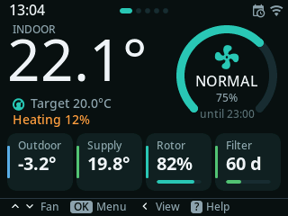 01_dashboard</td>
<td align="center">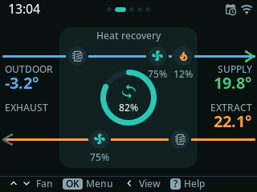 02_airflow</td>
<td align="center">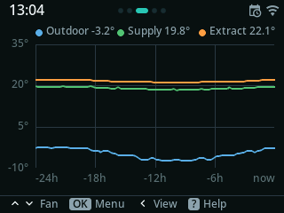 03_trends</td>
</tr>
<tr>
<td align="center">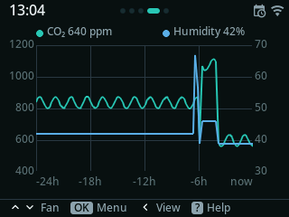 03b_sensors</td>
<td align="center">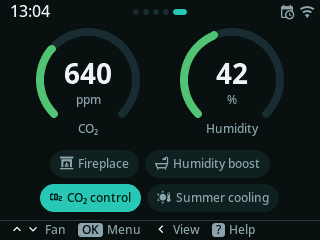 04_comfort</td>
<td align="center">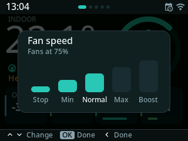 04c_fan_hud_opened</td>
</tr>
<tr>
<td align="center">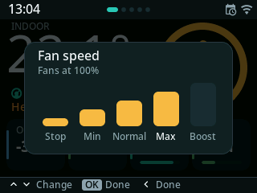 05_fan_hud_max</td>
<td align="center">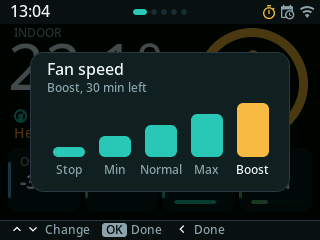 06_fan_hud_boost</td>
<td align="center">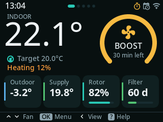 07_dashboard_boost</td>
</tr>
<tr>
<td align="center">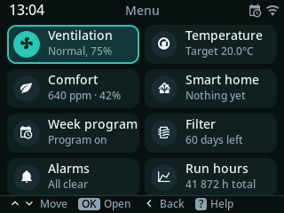 08_menu</td>
<td align="center">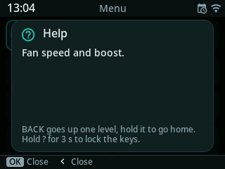 08b_menu_help</td>
<td align="center">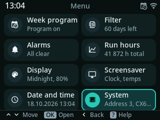 08c_menu_end</td>
</tr>
<tr>
<td align="center">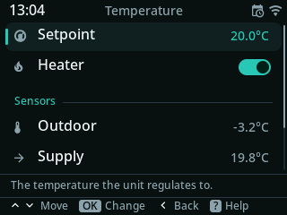 09_temperature</td>
<td align="center">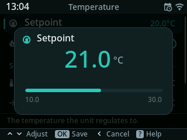 10_edit_setpoint</td>
<td align="center">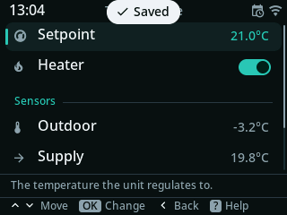 11_saved</td>
</tr>
<tr>
<td align="center">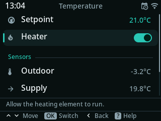 12_temperature_scrolled</td>
<td align="center">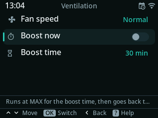 13_ventilation</td>
<td align="center">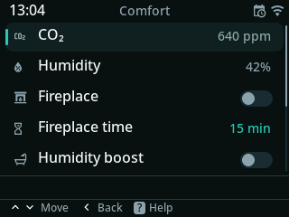 14_comfort_menu</td>
</tr>
<tr>
<td align="center">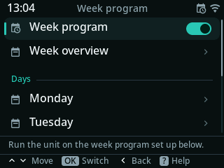 15_schedule_menu</td>
<td align="center">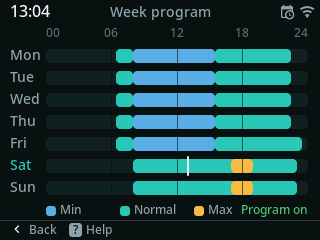 16_week_program</td>
<td align="center">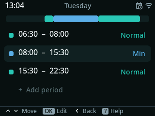 17_day</td>
</tr>
<tr>
<td align="center"> 17b_period</td>
<td align="center">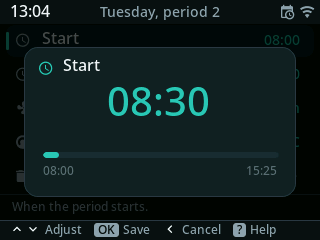 17c_period_start</td>
<td align="center">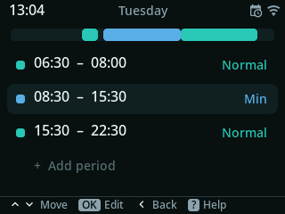 17d_day_changed</td>
</tr>
<tr>
<td align="center">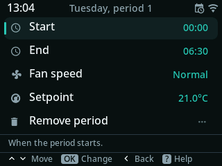 17e_period_added</td>
<td align="center">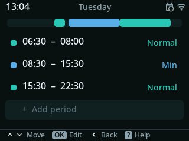 17f_period_removed</td>
<td align="center">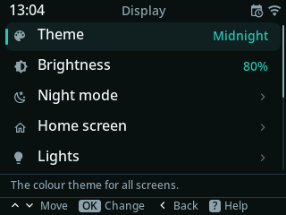 18_display_menu</td>
</tr>
<tr>
<td align="center">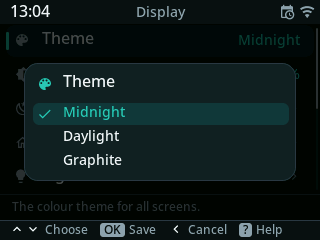 19_theme_picker</td>
<td align="center">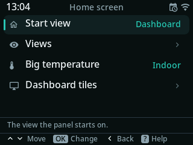 19a_home_screen</td>
<td align="center">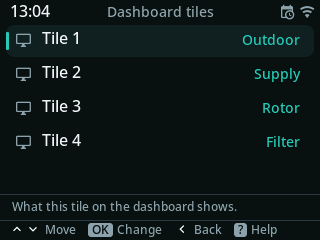 19b_tiles</td>
</tr>
<tr>
<td align="center">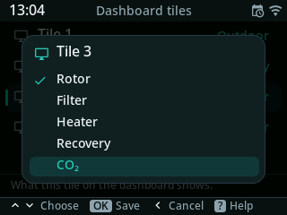 19c_tile_picker</td>
<td align="center"> 19d_dashboard_tiles</td>
<td align="center">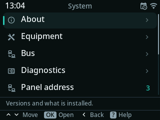 20_system_menu</td>
</tr>
<tr>
<td align="center">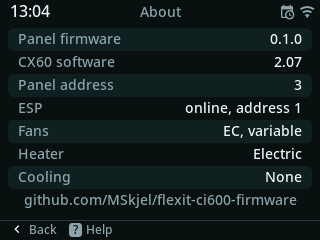 21_about</td>
<td align="center">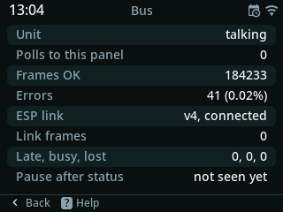 22_bus</td>
<td align="center">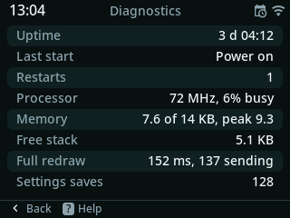 22b_diagnostics</td>
</tr>
<tr>
<td align="center">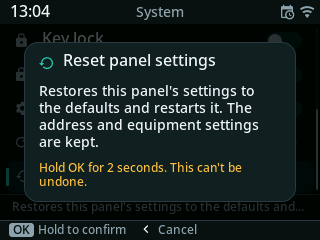 23_confirm</td>
<td align="center">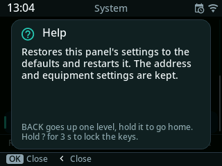 24_help</td>
<td align="center">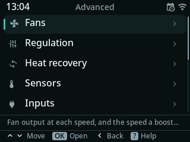 24b_advanced</td>
</tr>
<tr>
<td align="center">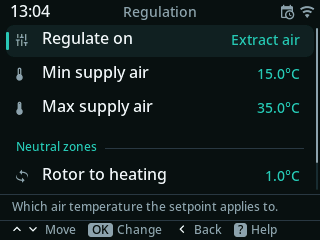 24c_advanced_regulation</td>
<td align="center">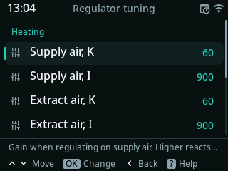 24d_advanced_tuning</td>
<td align="center">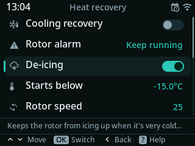 24e_advanced_deicing</td>
</tr>
<tr>
<td align="center">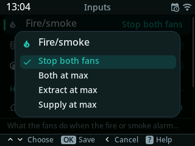 24f_advanced_fire</td>
<td align="center">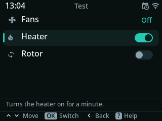 24g_advanced_test</td>
<td align="center">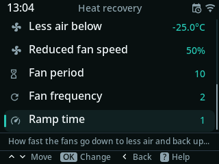 24h_advanced_deicing_end</td>
</tr>
<tr>
<td align="center">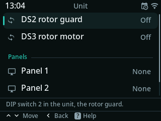 24i_advanced_unit</td>
<td align="center">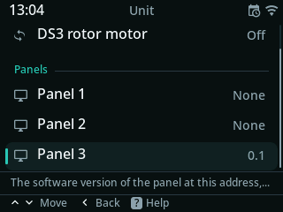 24j_advanced_unit_end</td>
<td align="center">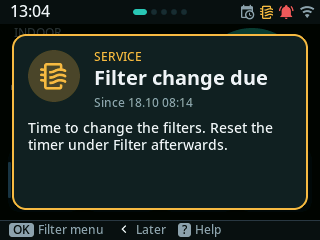 25_alarm_filter</td>
</tr>
<tr>
<td align="center">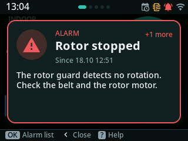 26_alarm_rotor</td>
<td align="center">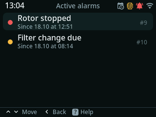 27_alarm_list</td>
<td align="center">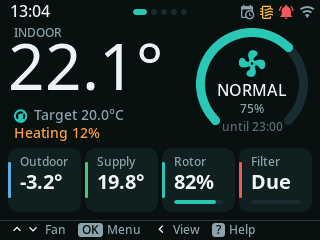 28_dashboard_alarms</td>
</tr>
<tr>
<td align="center">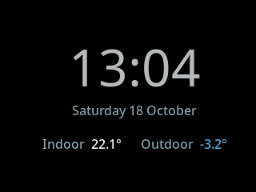 29_screensaver</td>
<td align="center"> 30_comfort_offline</td>
<td align="center"> 31_daylight_airflow</td>
</tr>
<tr>
<td align="center"> 32_daylight_menu</td>
<td align="center"> 33_graphite_menu</td>
<td align="center"> 34_graphite_trends</td>
</tr>
<tr>
<td align="center"> 35_equipment</td>
<td align="center"> 36_equipment_esp_off</td>
<td align="center"> 37_no_esp_dashboard</td>
</tr>
<tr>
<td align="center"> 38_no_esp_back_to_dashboard</td>
<td align="center"> 39_no_esp_menu</td>
<td align="center"> 40_no_esp_time</td>
</tr>
<tr>
<td align="center"> 41_no_esp_ventilation_ec</td>
<td align="center"> 42_no_esp_ventilation_ac</td>
<td align="center"> 50_smart_view</td>
</tr>
<tr>
<td align="center"> 51_smart_menu</td>
<td align="center"> 52_smart_toggled</td>
<td align="center"> 52b_item_help</td>
</tr>
<tr>
<td align="center"> 52c_item_edit</td>
<td align="center"> 52d_dashboard_text</td>
<td align="center"> 53_notification</td>
</tr>
<tr>
<td align="center"> 54_saver_picture</td>
<td align="center"> 55_saver_picture_clock</td>
<td align="center"> 56_saver_picture_all</td>
</tr>
<tr>
<td align="center"> 57_saver_moon_patch</td>
<td align="center"> 58_saver_dawn_palette</td>
<td align="center"> 58b_saver_animation</td>
</tr>
<tr>
<td align="center"> 58c_saver_animation_later</td>
<td align="center"> 58d_saver_animation_wrap</td>
<td align="center"> 59_saver_menu_picture</td>
</tr>
<tr>
<td align="center"> 59b_saver_menu_photo</td>
<td align="center"> 59c_saver_photo</td>
<td align="center"> 60_theme_from_esp</td>
</tr>
<tr>
<td align="center"> 61_view_from_esp</td>
<td align="center"> 62_bus_link</td>
<td align="center"> 62_no_contact</td>
</tr>
<tr>
<td align="center"> 62b_smart_page_2</td>
<td align="center"> 62c_smart_menu_end</td>
<td align="center"> 62d_smart_edit</td>
</tr>
<tr>
<td align="center"> 63_no_contact_menu</td>
<td align="center"> 64_key_lock</td>
<td align="center"> 65_night_menu</td>
</tr>
<tr>
<td align="center"> 66_display_menu_end</td>
<td align="center"> 67_airflow_exhaust</td>
<td align="center"> 68_dashboard_fans_differ</td>
</tr>
<tr>
<td align="center"> 70_standalone_dashboard</td>
<td align="center"> 71_standalone_menu</td>
<td align="center"> 72_standalone_display</td>
</tr>
<tr>
<td align="center"> 73_standalone_tile_picker</td>
<td align="center"> 74_standalone_view_picker</td>
<td align="center"> 75_standalone_saver_menu</td>
</tr>
<tr>
<td align="center"> 76_standalone_saver_picker</td>
<td align="center"> 77_standalone_time</td>
<td align="center"> 78_standalone_about</td>
</tr>
<tr>
<td align="center"> 79_standalone_bus</td>
<td align="center"> 79b_standalone_saver</td>
<td align="center"> 80_views</td>
</tr>
<tr>
<td align="center"> 81_saver_menu</td>
<td align="center"> 82_lights</td>
<td align="center"> 83_system_menu</td>
</tr>
<tr>
<td align="center"> 84_alarms_menu</td>
<td align="center"> 85_saver_shadow</td>
<td align="center"> 86_saver_shadow_top</td>
</tr>
<tr>
<td align="center"> 86b_saver_small_top</td>
<td align="center"> 86c_saver_small</td>
<td align="center"> 86d_saver_just_text</td>
</tr>
<tr>
<td align="center"> 87_saver_band_top</td>
<td align="center"> 87b_saver_lines</td>
<td align="center"> 87c_saver_lines_small</td>
</tr>
<tr>
<td align="center"> 87d_saver_lines_black</td>
<td align="center"> 87e_saver_lines_long</td>
<td align="center"> 88_dashboard_outdoor_whole</td>
</tr>
<tr>
<td align="center"> 89_night_theme</td>
<td align="center"> 90_only_the_dashboard</td>
<td align="center"> 93_processor_speed</td>
</tr>
<tr>
<td align="center"> 93a_processor_speeds</td>
<td align="center"> 93b_trial</td>
<td align="center"> 95_esp_screenshot</td>
</tr>
<tr>
<td align="center"> 95b_esp_screenshot_photo</td>
<td align="center"> theme0_dashboard</td>
<td align="center"> theme1_dashboard</td>
</tr>
<tr>
<td align="center"> theme2_dashboard</td>
</tr>
</table>

## In Norwegian

<table>
<tr>
<td align="center"> 01_dashboard</td>
<td align="center"> 02_airflow</td>
<td align="center"> 03_trends</td>
</tr>
<tr>
<td align="center"> 03b_sensors</td>
<td align="center"> 04_comfort</td>
<td align="center"> 04c_fan_hud_opened</td>
</tr>
<tr>
<td align="center"> 05_fan_hud_max</td>
<td align="center"> 06_fan_hud_boost</td>
<td align="center"> 07_dashboard_boost</td>
</tr>
<tr>
<td align="center"> 08_menu</td>
<td align="center"> 08b_menu_help</td>
<td align="center"> 08c_menu_end</td>
</tr>
<tr>
<td align="center"> 09_temperature</td>
<td align="center"> 10_edit_setpoint</td>
<td align="center"> 11_saved</td>
</tr>
<tr>
<td align="center"> 12_temperature_scrolled</td>
<td align="center"> 13_ventilation</td>
<td align="center"> 14_comfort_menu</td>
</tr>
<tr>
<td align="center"> 15_schedule_menu</td>
<td align="center"> 16_week_program</td>
<td align="center"> 17_day</td>
</tr>
<tr>
<td align="center"> 17b_period</td>
<td align="center"> 17c_period_start</td>
<td align="center"> 17d_day_changed</td>
</tr>
<tr>
<td align="center"> 17e_period_added</td>
<td align="center"> 17f_period_removed</td>
<td align="center"> 18_display_menu</td>
</tr>
<tr>
<td align="center"> 19_theme_picker</td>
<td align="center"> 19a_home_screen</td>
<td align="center"> 19b_tiles</td>
</tr>
<tr>
<td align="center"> 19c_tile_picker</td>
<td align="center"> 19d_dashboard_tiles</td>
<td align="center"> 20_system_menu</td>
</tr>
<tr>
<td align="center"> 21_about</td>
<td align="center"> 22_bus</td>
<td align="center"> 22b_diagnostics</td>
</tr>
<tr>
<td align="center"> 23_confirm</td>
<td align="center"> 24_help</td>
<td align="center"> 24b_advanced</td>
</tr>
<tr>
<td align="center"> 24c_advanced_regulation</td>
<td align="center"> 24d_advanced_tuning</td>
<td align="center"> 24e_advanced_deicing</td>
</tr>
<tr>
<td align="center"> 24f_advanced_fire</td>
<td align="center"> 24g_advanced_test</td>
<td align="center"> 24h_advanced_deicing_end</td>
</tr>
<tr>
<td align="center"> 24i_advanced_unit</td>
<td align="center"> 24j_advanced_unit_end</td>
<td align="center"> 25_alarm_filter</td>
</tr>
<tr>
<td align="center"> 26_alarm_rotor</td>
<td align="center"> 27_alarm_list</td>
<td align="center"> 28_dashboard_alarms</td>
</tr>
<tr>
<td align="center"> 29_screensaver</td>
<td align="center"> 30_comfort_offline</td>
<td align="center"> 31_daylight_airflow</td>
</tr>
<tr>
<td align="center"> 32_daylight_menu</td>
<td align="center"> 33_graphite_menu</td>
<td align="center"> 34_graphite_trends</td>
</tr>
<tr>
<td align="center"> 35_equipment</td>
<td align="center"> 36_equipment_esp_off</td>
<td align="center"> 37_no_esp_dashboard</td>
</tr>
<tr>
<td align="center"> 38_no_esp_back_to_dashboard</td>
<td align="center"> 39_no_esp_menu</td>
<td align="center"> 40_no_esp_time</td>
</tr>
<tr>
<td align="center"> 41_no_esp_ventilation_ec</td>
<td align="center"> 42_no_esp_ventilation_ac</td>
<td align="center"> 50_smart_view</td>
</tr>
<tr>
<td align="center"> 51_smart_menu</td>
<td align="center"> 52_smart_toggled</td>
<td align="center"> 52b_item_help</td>
</tr>
<tr>
<td align="center"> 52c_item_edit</td>
<td align="center"> 52d_dashboard_text</td>
<td align="center"> 53_notification</td>
</tr>
<tr>
<td align="center"> 54_saver_picture</td>
<td align="center"> 55_saver_picture_clock</td>
<td align="center"> 56_saver_picture_all</td>
</tr>
<tr>
<td align="center"> 57_saver_moon_patch</td>
<td align="center"> 58_saver_dawn_palette</td>
<td align="center"> 58b_saver_animation</td>
</tr>
<tr>
<td align="center"> 58c_saver_animation_later</td>
<td align="center"> 58d_saver_animation_wrap</td>
<td align="center"> 59_saver_menu_picture</td>
</tr>
<tr>
<td align="center"> 59b_saver_menu_photo</td>
<td align="center"> 59c_saver_photo</td>
<td align="center"> 60_theme_from_esp</td>
</tr>
<tr>
<td align="center"> 61_view_from_esp</td>
<td align="center"> 62_bus_link</td>
<td align="center"> 62_no_contact</td>
</tr>
<tr>
<td align="center"> 62b_smart_page_2</td>
<td align="center"> 62c_smart_menu_end</td>
<td align="center"> 62d_smart_edit</td>
</tr>
<tr>
<td align="center"> 63_no_contact_menu</td>
<td align="center"> 64_key_lock</td>
<td align="center"> 65_night_menu</td>
</tr>
<tr>
<td align="center"> 66_display_menu_end</td>
<td align="center"> 67_airflow_exhaust</td>
<td align="center"> 68_dashboard_fans_differ</td>
</tr>
<tr>
<td align="center"> 70_standalone_dashboard</td>
<td align="center"> 71_standalone_menu</td>
<td align="center"> 72_standalone_display</td>
</tr>
<tr>
<td align="center"> 73_standalone_tile_picker</td>
<td align="center"> 74_standalone_view_picker</td>
<td align="center"> 75_standalone_saver_menu</td>
</tr>
<tr>
<td align="center"> 76_standalone_saver_picker</td>
<td align="center"> 77_standalone_time</td>
<td align="center"> 78_standalone_about</td>
</tr>
<tr>
<td align="center"> 79_standalone_bus</td>
<td align="center"> 79b_standalone_saver</td>
<td align="center"> 80_views</td>
</tr>
<tr>
<td align="center"> 81_saver_menu</td>
<td align="center"> 82_lights</td>
<td align="center"> 83_system_menu</td>
</tr>
<tr>
<td align="center"> 84_alarms_menu</td>
<td align="center"> 85_saver_shadow</td>
<td align="center"> 86_saver_shadow_top</td>
</tr>
<tr>
<td align="center"> 86b_saver_small_top</td>
<td align="center"> 86c_saver_small</td>
<td align="center"> 86d_saver_just_text</td>
</tr>
<tr>
<td align="center"> 87_saver_band_top</td>
<td align="center"> 87b_saver_lines</td>
<td align="center"> 87c_saver_lines_small</td>
</tr>
<tr>
<td align="center"> 87d_saver_lines_black</td>
<td align="center"> 87e_saver_lines_long</td>
<td align="center"> 88_dashboard_outdoor_whole</td>
</tr>
<tr>
<td align="center"> 89_night_theme</td>
<td align="center"> 90_only_the_dashboard</td>
<td align="center"> 93_processor_speed</td>
</tr>
<tr>
<td align="center"> 93a_processor_speeds</td>
<td align="center"> 93b_trial</td>
<td align="center"> 95_esp_screenshot</td>
</tr>
<tr>
<td align="center"> 95b_esp_screenshot_photo</td>
<td align="center"> theme0_dashboard</td>
<td align="center"> theme1_dashboard</td>
</tr>
<tr>
<td align="center"> theme2_dashboard</td>
</tr>
</table>

## Pictures the ESP makes

<table>
<tr>
<td align="center"> esp_animation</td>
<td align="center"> esp_animation_copies</td>
<td align="center"> esp_photo</td>
</tr>
<tr>
<td align="center"> esp_picture</td>
<td align="center"> esp_picture_moon</td>
<td align="center"> esp_screen_camera</td>
</tr>
<tr>
<td align="center"> esp_weather</td>
<td align="center"> esp_weather_forecast</td>
</tr>
</table>

## The ESP's weather picture

<table>
<tr>
<td align="center"> 01_clear_noon</td>
<td align="center"> 02_fair</td>
<td align="center"> 03_sunset</td>
</tr>
<tr>
<td align="center"> 04_blue_hour</td>
<td align="center"> 05_moon_night</td>
<td align="center"> 06_overcast_night</td>
</tr>
<tr>
<td align="center"> 07_light_rain</td>
<td align="center"> 08_heavy_rain</td>
<td align="center"> 09_snow</td>
</tr>
<tr>
<td align="center"> 10_thunder</td>
<td align="center"> 11_fog</td>
<td align="center"> 12_cirrus_sunrise</td>
</tr>
<tr>
<td align="center"> 13_no_weather</td>
<td align="center"> 14_real</td>
<td align="center"> 15_fair_forecast</td>
</tr>
<tr>
<td align="center"> 16_night_forecast</td>
<td align="center"> 17_rain_forecast</td>
<td align="center"> 18_snow_forecast</td>
</tr>
<tr>
<td align="center"> 19_sunset_forecast</td>
<td align="center"> 20_real_forecast</td>
<td align="center"> 21_spring</td>
</tr>
<tr>
<td align="center"> 22_winter_bare</td>
<td align="center"> 23_snowy_spruces</td>
<td align="center"> 24_coast</td>
</tr>
<tr>
<td align="center"> 25_coast_night</td>
<td align="center"> 26_mountains</td>
<td align="center"> 27_mountains_winter_night</td>
</tr>
<tr>
<td align="center"> 28_city_night</td>
<td align="center"> 29_city_day</td>
<td align="center"> 30_stars_orion</td>
</tr>
<tr>
<td align="center"> 31_aurora</td>
<td align="center"> 32_rainbow</td>
<td align="center"> 33_smoke_flag</td>
</tr>
<tr>
<td align="center"> 34_fireplace</td>
</tr>
</table>

## Replayed bus captures

<table>
<tr>
<td align="center"> real_airflow</td>
<td align="center"> real_alarm_log</td>
<td align="center"> real_dashboard</td>
</tr>
</table>
